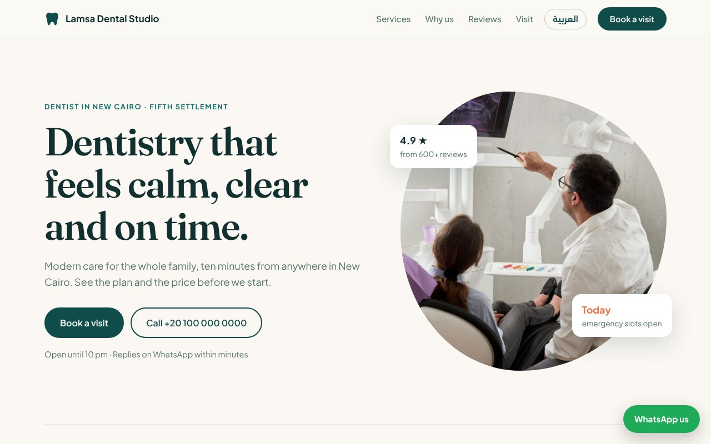
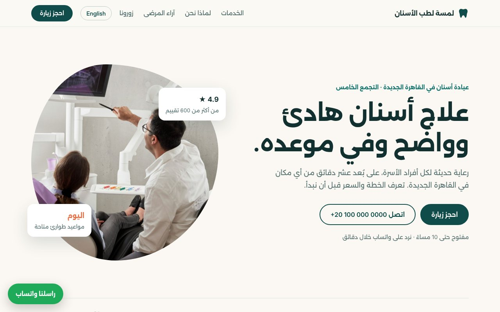
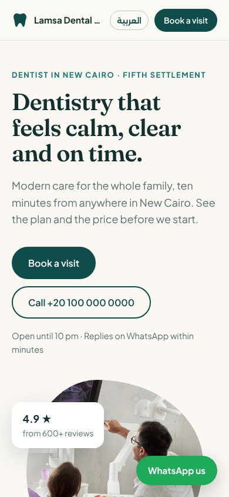
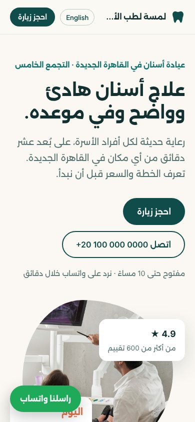

# Dental clinic demo: Lamsa Dental Studio

A one-page website for a fictional dental clinic in New Cairo, in English and Arabic.
It is a demo of the "Launch" one-page package and the base for client mockups.

Built by [Mostafa Habib](https://mostafahabib.space/): secure, fast websites for small businesses.

| English | Arabic |
| --- | --- |
|  |  |
|  |  |

## What it shows

- One page that works on phones: services, reasons to choose the clinic, reviews, booking, map and hours.
- English and Arabic with a language switch. Arabic is laid out right to left. `?lang=ar` opens Arabic directly.
- A booking form that opens a ready-to-send WhatsApp message, plus a floating WhatsApp button and a call button.
- Security headers on every response (`public/_headers`): a strict Content Security Policy, HSTS, no framing, no MIME sniffing.
- No outside requests except the Google Maps frame. Fonts are served from the site itself.
- Hidden from search engines (`noindex`), because the clinic is fictional.

## Run it

```bash
npm install
npm run dev      # local preview
npm run build    # production files in dist/
```

Tech: React 19, Vite 8, plain CSS. No other dependencies.

## Make a mockup for a real clinic

Everything clinic-specific is in `src/clinic.js`. The page title, description and share tags are built from it.

1. Set `mode: 'mockup'`. The footer then says the page is a design mockup and not the clinic's official site.
2. Replace the name, address, phone, WhatsApp number, map search, hours and services in both `en` and `ar`.
3. Use only facts the clinic has published. Set `stats`, `chips` and `reviews` to `[]` unless the numbers and quotes are real. Those sections hide themselves when empty. Never show invented reviews or ratings under a real clinic's name.
4. Optional: swap the hero photo. Put a file in `public/` and set `photo: '/your-file.jpg'`, or set `photo: ''` to show the tooth illustration instead.
5. Optional: change the colours at the top of `src/index.css`.

## Before it goes live (not done yet)

- Set `siteUrl` in `src/clinic.js` to the live address, then rebuild. This switches on the link-preview tags (`og:image`, `og:url`, canonical). The preview image is `public/og-image.jpg` (1200 x 630).
- `public/_headers` is in Cloudflare's format and is copied into `dist/` by the build. Any other host needs the same headers set its own way.
- After deploying, test the address at securityheaders.com and with PageSpeed Insights.
- If you add an outside service (analytics, a video, a booking widget), allow it in the Content Security Policy in `public/_headers`, or the browser blocks it.
- The phone and WhatsApp numbers are placeholders. Messages sent from the form go to that placeholder number.

## Fonts

Fraunces, Plus Jakarta Sans and Alexandria, each under the SIL Open Font License 1.1, taken from the Fontsource packages. Files are in `src/assets/fonts/`.

## Photo

The hero photo (`public/clinic.jpg`) is by Caroline LM on Unsplash, used under the Unsplash licence. Replace it with the clinic's own photo in a mockup.
